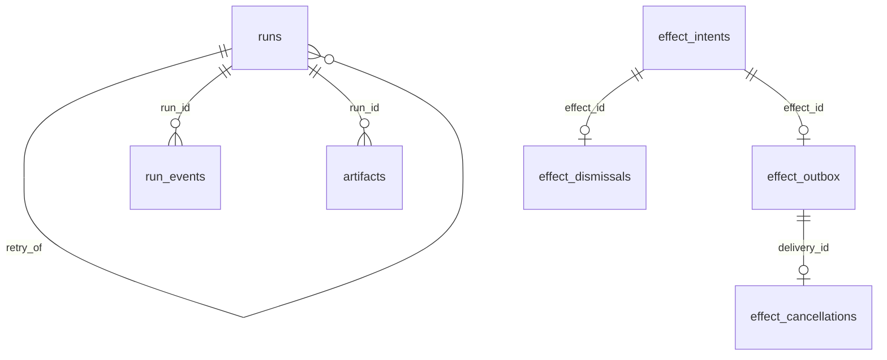
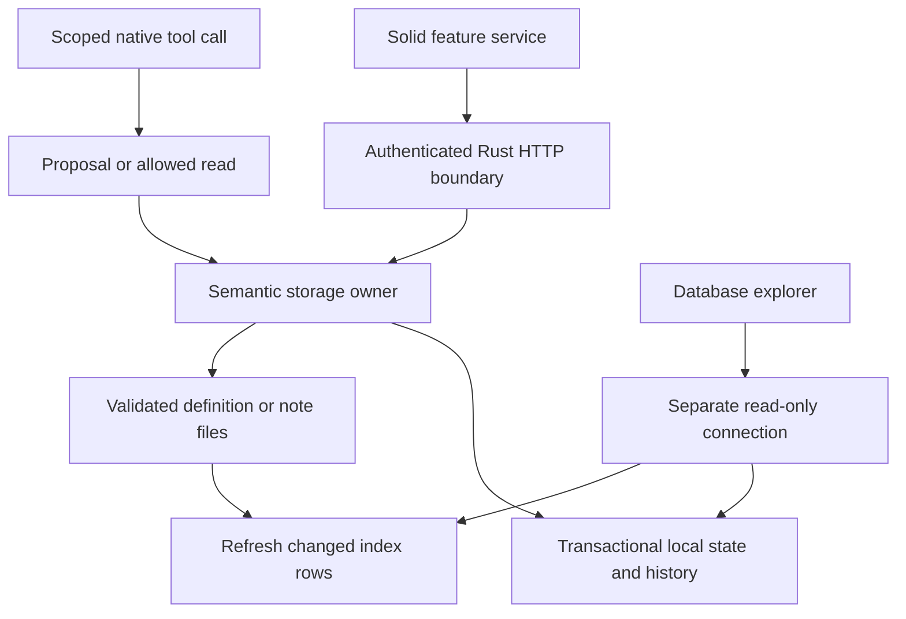

# Storage and database ownership

Inferay is a local application with five SQLite databases and file-backed project definitions. There is no single universal database, and no generic SQL mutation API. **An index can be rebuilt; authoritative state cannot.** `projects.sqlite3` contains both kinds, so deleting that entire file is not an index reset.

Use **Settings → Database** to browse the active profile. Choose a store and a table, filter rows by a literal substring, sort a column, or open Schema. Click a cell to inspect its contents; large values load in chunks. The schema view includes actual CREATE SQL, declared column types, NOT NULL/defaults, primary-key positions, generated/hidden columns, foreign keys, index columns/expressions/collations and triggers. Foreign-key targets are navigable. SQLite internal and FTS shadow tables remain visible and labeled.

The machine-readable [schema reference](reference/database-schema.json) contains every table, column, constraint in stored SQL, index, and trigger created by the production initializers in a fresh profile. It is generated, not hand-maintained. The explorer reads the **actual profile**; an older profile may retain extra migration artifacts. [API contracts](api.md) describe inspection queries and generated types. [MCP](mcp.md) describes agent tools and their authority.

## Profile layout and sources of truth

The default macOS profile is `~/Library/Application Support/Inferay/`; `INFERAY_USER_DATA_DIR` overrides it for development and tests. Other platforms use the host's configured data location. Never hardcode a production profile in a test or generator.

```text
<profile>/
  projects/<project-id>/
    project.json
    automations/<id>/automation.json
    plugins/<slug>/
      plugin.json, README.md
      src/, assets/, source/
      tools/<name>/tool.json + implementation
      skills/<name>.md
      automations/<name>.json
    memory/
      notes/*.md
      documents/*
      <record-type>/*.json
    files/
    runs/<run-id>/inputs/, logs/, output/
  projects.sqlite3         definitions index + approvals + execution history
  memory.sqlite3           rebuildable note/relationship/full-text index
  chat.sqlite3             authoritative conversation state
  skills.sqlite3           authoritative global custom skills
  client-storage.sqlite3   authoritative interface preferences and panel state
  projects.lock            profile writer lease
  agent-state.json         workspace/pane hierarchy and selection
  settings.json            configured search folders
  agent-context.json       global/project context settings
  checkpoints.json, mcp-*.json, backgrounds/, …
```

`client-storage.json` and `prompts.json` can remain as historical import inputs. They are not the authoritative stores after successful import. Local files are not automatically encrypted; transcripts, prompts and notes can contain private material. Keychain connection secrets are managed by the connection owner and do not belong in schema exports, tool arguments, run snapshots or documentation. See [connections](connections.md).

| Store | Semantic owner in `native/server/src` | Authority | Initialization and durability |
|---|---|---|---|
| `projects.sqlite3` | `project_store`, `project_index`, `project_file_store`, `project_runs`, `project_effects` | Mixed: files own definitions; DB owns approvals, bindings, proposals, run/effect history | Startup obtains `projects.lock`, opens schema version 3, enables foreign keys, WAL, FULL synchronization and a 5s busy timeout; refreshes indexes and recovers interrupted work |
| `memory.sqlite3` | `memory_store` | Rebuildable search/link index of note files | Creates notes/links/errors/FTS5 tables on open; WAL and 5s busy timeout; sync on memory access. No explicit `user_version` migration ledger or synchronous override |
| `chat.sqlite3` | `chat_persistence` | Authoritative pane documents and transcripts | Lazy writer worker; WAL, FULL synchronization, fullfsync, 2MiB cache and 256-page autocheckpoint; bounded queue and grouped commits |
| `skills.sqlite3` | `prompt_store` | Authoritative custom global skills; bundled skills remain external | Open at startup; WAL/FULL/5s timeout; transactional `global-skills-v1` import receipt; refuses incompatible project profiles before import |
| `client-storage.sqlite3` | `client_storage` | Authoritative per-key JSON preferences | Lazy open; WAL/FULL/5s timeout; transactional schema-version-1 import of legacy JSON; failed imports do not publish partial state |

Connection PRAGMAs are not global guarantees. For example, foreign-key enforcement belongs to each writer connection. The explorer's read-only connection cannot establish whether every writer enables it. WAL mode persists at the database level; busy timeout and query-only policy do not.

## Table families and actual relationships

### Projects

Seven definition indexes share `id`, `project_id`, optional `plugin_id`, `source_path`, `source_hash`, `valid`, `error` and JSON `body`: `projects`, `resources`, `plugins`, `tools`, `automations`, `resource_types`, `project_skills`. Each has a unique `(project_id, source_path)` and a `(project_id, valid)` index. `body` can be NULL for invalid content. `definition_errors` preserves path-level validation failures.

| Authoritative table | What it owns |
|---|---|
| `automation_state` | Enablement, next due time, approved input hash/time, changed-input flag and error |
| `plugin_state` | Approved hash/time and captured `approved_inputs` JSON |
| `project_proposals` | Message identity, command hash, project, applying/saved/declined state, output/entity identity and accepted edited command |
| `repository_paths` | Local checkout binding per project and repository ID |
| `project_conversations` | Pane-to-project association |
| `runs` | Automation/project identity, unique request key, occurrence/retry identity, captured snapshot/hash, status, times, stop request, result/error |
| `run_events` | Ordered `(run_id, sequence)` event stream; FK to `runs` |
| `artifacts` | Run outputs, paths, byte sizes and hashes; FK to `runs` |
| `effect_intents` | Captured external-action proposals, deduplicated by `(project_id, intent_key)` |
| `effect_dismissals` | Dismissed intent hash/time; FK to `effect_intents` |
| `effect_limits` | Revisioned limit records per project/kind/target; storage exists, not a complete delivery product |
| `effect_outbox` | Unique effect reservation, scope, pinned hashes, queued/in-flight/uncertain/delivered/cancelled state, timing and receipt; FK to intent |
| `effect_cancellations` | Cancellation requests; FK to delivery |

Declared relationships are deliberately narrower than the domain graph:



The diagram shows declared FKs, not all logical references or lifecycle guarantees. Project/automation/plugin IDs also appear in history and snapshots without FKs to the rebuildable definition index. Deleting or temporarily invalidating a definition must not erase its execution history. Cross-database pane and skill references are application relationships, not SQLite foreign keys.

The project schema's base version is 3. `project_index::create_schema` also adds `accepted_command` and `approved_inputs` when missing; effect tables initialize idempotently. `user_version=3` alone is therefore **not** an exhaustive feature/schema fingerprint. The live schema is the definitive structural view. Column/index introspection uses SQLite’s [table_xinfo, index_xinfo and foreign_key_list PRAGMAs](https://sqlite.org/pragma.html).

### Memory

`notes` has composite primary key `(project, id)` and is `WITHOUT ROWID`. Its columns include path, title, tags, source, created, supersedes, expires, stamp and body. The stamp combines file size and modification time. `notes_recent` and `notes_supersedes` support project-scoped retrieval. `links` records outgoing targets and has forward/reverse lookup indexes; unresolved links are allowed. `errors` records file parse problems. `notes_fts` uses FTS5 with `porter unicode61`; its shadow tables belong to SQLite and are not separate domain entities.

Sync reads changed note files and updates the note, FTS and link representations together through the memory owner. Supersession and link targets are logical references: enforcing that every target exists would prevent useful forward links. Memory documents and typed records live in files; do not assume every file type is a row in the note-search index. Read-only explorer inspection does not invoke memory sync.

### Chat

`documents(pane, kind, body)` stores JSON documents such as session, context and queue. `transcripts(pane, epoch, revision)` owns transcript generation/revision identity. `transcript_messages(pane, position, body)` owns ordered JSON messages. `retired_epochs(pane, epoch)` prevents old generations from being revived.

A dedicated writer thread accepts at most 64 queued jobs and groups up to 64 waiting operations into a commit. Each job has a savepoint; a bad job can roll back without discarding its neighbors. Publication/acknowledgement follows the durable outer commit. Reads used by that owner also pass through its sequencing. Transcript replacement, append/revision rules and clearing sessions belong here, not in renderer SQL. Chat tables currently have no declared cross-table FKs: transaction code enforces their lifecycle.

### Skills and interface state

`skills(id, body)` stores checked JSON for custom global skills; `migrations(name)` records the completed legacy import. The loaded library merges these with bundled defaults. Built-in skills cannot be overwritten as custom edits. `PromptStore` owns create/update/delete and accepted proposals, including revision conflict checks.

`entries(key, value)` in client storage stores JSON values. `None` in the update command removes a key; JSON `null` is an explicit stored value. Updates commit only changed values together. Bootstrap selects keys before loading values and excludes legacy transcript bodies/checkpoint associations; an explicit keyed read may still retrieve them. Some established preference values contain serialized JSON strings inside the JSON value; preserve the owner's encoding rather than normalizing them opportunistically.

## How the app builds, reads and changes data



1. Server startup resolves the active profile and storage owners. Project ownership is exclusive at the application level. SQLite still owns database locking and WAL recovery.
2. Project definitions are parsed and validated at the file boundary. Optimistic source/input hashes prevent accepting stale edits or stale approval. Writes use the file owner's atomic replacement/bundle mechanisms.
3. Index refresh scans and validates files, upserts changed rows and removes missing index rows in a transaction. Reading the project catalogue can refresh this index; an application-level “read” is not necessarily zero I/O or zero index writes.
4. File replacement and a SQLite commit are **not one cross-resource ACID transaction**. Files remain authoritative; later refresh reconciles the index. Proposal receipts and recovery logic address their own interrupted states.
5. Approval pins execution inputs. Changed input hashes disable automation enablement until review; copied files never convey approval. The scheduler checks due work, captures input evidence and records a run before execution.
6. Run events/artifacts and completion states are recorded through the run owner. Restart marks interrupted running jobs honestly; effects left in flight recover as uncertain. Neither recovery nor an intent artifact proves an external action succeeded.
7. The renderer loads typed responses through feature services using the shared native HTTP client. Generated Rust contracts are the type source of truth. The database module is an independent reader; it never imports writer internals into the UI.

### Supported operations and their owners

| Surface/action | Reads/writes and constraints |
|---|---|
| Explorer list/schema/rows/cell | Read-only, five allowlisted stores, no SQL editor, arbitrary path, DDL, insert, update or delete |
| Project catalogue/history | Reads index/state; catalogue refreshes changed definitions; history paginates runs |
| `createPlugin`, `updatePlugin` | Validated file bundles; update checks expected library hash and explicit removals; agent calls prepare proposal cards |
| `saveDefinition` | Validated file write with expected source hash; agent surface accepts automation proposals, not arbitrary writes |
| `readPlugin`, `reviewPlugin`, `reviewAutomation` | Inspect content and captured execution inputs; available to agents |
| `approvePlugin`, `approveAutomation` | User/host action checking expected input hash; records local approval and optional enablement |
| `disablePlugin`, `disableAutomation` | User/host action changing local execution state |
| `runAutomation`, `retryRun` | User/host request with request identity; records/queues work subject to approved inputs and retry rules |
| `stopRun` | User/host stop request, coordinated with runtime cancellation |
| `saveProject` | Validated `project.json` plus local repository bindings; expected source hash |
| `editRepository` | Add, relink or remove binding/declaration; refuses removal while tools/automations depend on it |
| `associateConversation` | Local pane/project association |
| Proposal review/save/decline | `project_proposals` identity, conflict/recovery and accepted edit handling; does not bypass validation |
| Memory search/read/graph | Sync files, query index, read note or graph; read evidence can be recorded in runs |
| Memory save/delete, document upload | Explicit user-directed operations; writes/removes managed files and refreshes index; automation memory writes are refused |
| Skills list/read/create/update/delete/proposal | `PromptStore`; agent proposal alone does not save; accepted revision checked by the UI path |
| Interface state read/update | `ClientStorage`; keyed JSON, changed-key transaction; renderer has no SQL |
| Chat persist update/session/context/queue | `ChatPersistence`; ordered durable operations and transcript epochs; queue GET/PATCH routes are validated adapters |
| Effects list/dismiss/cancel | Captured intent/review state; cancellation isn't proof an already in-flight action did not happen |
| Connection list/commands | Connection owner plus Keychain; not a generic database credential editor |
| Backup, restore, integrity check, VACUUM, index repair, schema migration | Maintenance concepts, **not exposed explorer actions**. Use SQLite-aware procedures and the owner’s migration/recovery path |

Exact project command fields live in the generated `ProjectFileCommand` renderer type and [project file reference](reference/project-files.md). The [MCP reference](reference/mcp-tools.json) includes the current help/action examples. [API documentation](api.md) maps application endpoints and contract coverage.

## Do and don't

**Do:** decide which owner is authoritative before editing; change definitions through validated commands; keep writer transactions short; bind values and quote validated identifiers; test crash/conflict/failure invariants; preserve stable IDs and historical snapshots; add query-driven indexes; return exact large integers as strings to JavaScript; treat NULL, empty strings and binary data distinctly; regenerate reference artifacts when schema or tools change.

**Don't:** edit approvals or enabled flags with SQL; rebuild a mixed/authoritative database as if it were a disposable cache; update FTS shadow tables directly; treat JSON columns as automatically relational or automatically wrong; add a second renderer schema model; claim foreign keys exist because two columns share a name; cascade-delete history when a definition disappears; perform raw SQL based on user-controlled identifiers; store secrets in documents/snapshots; run migrations or schema-generation against the user's live profile.

For backup, use SQLite's backup facility or close the application and copy a consistent profile. Copying a live `.sqlite3` alone can omit committed WAL content. A multi-database backup plus files also needs an application-consistent point in time; five individually consistent backups are not automatically one consistent application snapshot. Restore to a separate profile and validate before replacing an existing one. The explorer does not implement backup/restore, and opening it never performs a migration.

## What is sound, what could improve

These are assessments and future work, not changes silently applied to user data:

- **Sound:** files retain portable human-owned definitions; local approval is separated from copied content; typed commands and hashes constrain writes; durable transcript acknowledgements and run evidence preserve what happened. Keeping history independent of rebuildable indexes is intentional.
- **Migration bookkeeping:** project version 3 plus conditional ALTERs, skills receipts, and unversioned memory/chat setup are several policies. Introduce an ordered migration ledger within each authoritative owner when its schema next changes; exercise upgrade, rollback/failure and newer-schema refusal. Do not make the explorer a migration runner.
- **Relational chat constraints:** evaluate FKs from messages/documents to a canonical pane/transcript identity, but first model empty queues, independent documents, retired epochs and pane restoration. A reflexive cascade to `transcripts` could delete state that intentionally outlives a transcript.
- **Logical project references:** FKs to rebuildable definition indexes would be harmful for retained history. If stronger referential integrity is needed, introduce durable identities/tombstones only after defining deletion semantics. For state tables, audit orphan cleanup and validate ownership before considering new constraints.
- **JSON versus columns:** snapshots, tool payloads and provider messages naturally retain JSON. Frequently filtered/joined values should become typed columns or indexed generated projections when actual queries justify them. Avoid a parallel DTO/domain/row hierarchy that only copies the same fields.
- **Memory integrity:** links need project scoping and intentional dangling-target behavior. Stamp-based detection can miss content changed with preserved size/mtime; hashes are stronger but cost reads. Benchmark before changing sync. FTS and notes must stay transactionally coordinated.
- **Query plans:** inspect actual hot paths before adding indexes. `effect_intents(project_id,run_id)` supports project/run filtering; reverse lookup and cleanup needs should be measured. Avoid redundant indexes on the same key prefixes without evidence.
- **Durability and operations:** document writer-specific pragma choices, retention and backup objectives. Separate fixture-tested maintenance tools would be needed for user-facing backup/restore, integrity reports and orphan repair.
- **Explorer limits:** pages are separate live snapshots, not a frozen browsing session; views have no stable row identity; very wide/slow objects can exceed the bounded reader budget. Keyset pagination, cancellable scans, richer value filters and export are candidates if real use demands them. They are not implemented promises.

## Explorer implementation and limits

`native/server/src/database_explorer/` owns SQLite inspection, its HTTP adapter and regression tests. `src/modules/database/` owns its service and component family. Settings only hosts the feature. No generic provider framework, extra database copy or write API is introduced.

Connections use SQLite read-only open flags, `query_only`, untrusted-schema mode, a 500ms busy timeout and a 2s VM-progress budget in blocking workers. Each request holds its own read transaction. Identifiers must exist in the inspected schema; filter values and row keys are bound parameters. The endpoint is protected by the same local authentication/origin checks as other app APIs. Responses are not browser-cacheable; row/cell query data is released when unused. This is a developer inspection surface and does not redact stored values.

Rows: limit 1–100 (UI 50), offset ≤1,000,000, ≤200 visible columns, filter ≤1,000 bytes. Previews contain up to 512 text characters/blob bytes. Cell chunks contain 65,536 units. Integers remain decimal strings; blobs are hex; NULL remains null. The opaque key uses rowid when available or ordered primary-key values for `WITHOUT ROWID` tables; a key over 65,536 bytes is withheld. Keyless views support previews. Chunk reads can observe concurrent updates; row keys are not permanent business IDs. `NOT NULL` is the declaration from SQLite, not a claim that no other constraint implies non-nullability.
